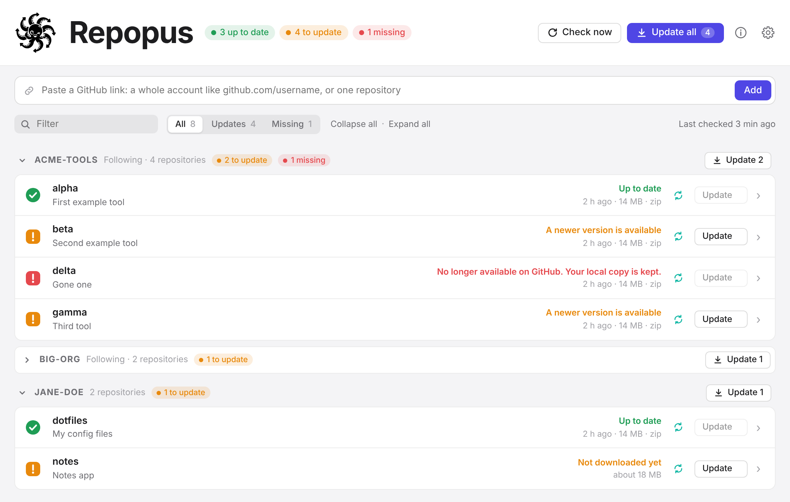

<p align="center">
  
</p>

<h1 align="center">Repopus</h1>

<p align="center">
  <strong>Keep local copies of your GitHub repositories, always up to date.</strong><br>
  Follow whole accounts or single repositories. Repopus checks GitHub for you, downloads only
  what changed, and never deletes anything that disappears.
</p>

<p align="center">
  <a href="../../releases/latest">Download</a> ·
  <a href="https://repopus.app">Website</a> ·
  <a href="docs/DEVELOPMENT.md">Build from source</a>
</p>

<p align="center">
  
  
  
  
</p>

<picture>
  <source media="(prefers-color-scheme: dark)" srcset="docs/screenshot-dark.png">
  
</picture>

---

## What it does

Paste a GitHub link and Repopus takes care of the rest:

- **A whole account**, like `github.com/username`, follows every repository it has, including
  new ones as they appear.
- **A single repository**, like `github.com/username/project`, adds just that one. Add
  `/tree/<branch>` to follow a specific branch.

Every account gets its own category, with one line per repository:

| Mark | Meaning |
|:---:|---|
| ✅ | Up to date |
| 🟧 | A newer version is available, or it hasn't been downloaded yet |
| 🟥 | Gone from GitHub (your copy is **kept**), missing on your computer, or an error |

## Features

- **Checks before it downloads.** Only repositories whose latest commit differs from your copy
  are downloaded. Checks that find nothing new cost (almost) nothing.
- **Automatic updates.** Checks every hour by default, quietly from the menu bar or system tray.
  Choose per repository whether it updates by itself.
- **Zip or folder.** Keep each repository as a zip archive or as an unpacked folder.
- **Replace or keep versions.** One up-to-date copy, or every version side by side, named by
  date and commit, optionally limited to the last *N*.
- **Your folders.** Everything goes into `~/Repopus/<account>/` by default, or anywhere you choose,
  per repository.
- **Safe by design.** Downloads are verified before they replace anything, so an interrupted
  download never breaks a copy. Repositories that vanish from GitHub stay on your computer.
  Repopus only ever removes files it created itself.
- **Foldable categories**, filters, search, live download progress and **Update all**, globally
  or per account.
- **Light, dark grey, or follow the system.**
- **macOS, Windows and Linux.**

## Install

Download the latest version for your system from the [**Releases**](../../releases/latest) page:

| System | File |
|---|---|
| macOS (Apple Silicon) | `Repopus_<version>_aarch64.dmg` |
| macOS (Intel) | `Repopus_<version>_x64.dmg` |
| Windows | `Repopus_<version>_x64-setup.exe` or `.msi` |
| Linux | `.AppImage` (any distribution), `.deb` (Debian, Ubuntu) or `.rpm` (Fedora, openSUSE) |

> **First start:** the installers aren't code-signed yet. On macOS, right-click the app →
> **Open** the first time. On Windows, choose **More info → Run anyway** if SmartScreen asks.
> On Linux, the tray icon needs AppIndicator support (on GNOME: the "AppIndicator" extension).

## GitHub token (optional)

Without a token, GitHub allows 60 requests an hour and only public repositories. That's enough
for a handful of repositories. For more, or for your private ones, add a token in **Settings**:

- Repopus uses the login of the [GitHub CLI](https://cli.github.com) automatically if you have it
  (`gh auth login`), or
- create a [fine-grained token](https://github.com/settings/personal-access-tokens/new) with
  read-only access to **Contents** and paste it into Settings.

The token is stored in your system's own keychain (macOS Keychain, Windows Credential Manager or
the Linux Secret Service), never in a plain file.

## Privacy

Repopus only talks to GitHub. No accounts, no tracking, no analytics. Your settings stay in a
small file on your computer.

## Build from source

Repopus is written in Rust with [Tauri](https://tauri.app); the interface is plain HTML, CSS
and JavaScript, with no Node.js needed.

```sh
cargo install tauri-cli --version "^2" --locked
cargo tauri dev       # run it
cargo tauri build     # make installers for your system
```

See [**docs/DEVELOPMENT.md**](docs/DEVELOPMENT.md) for requirements per system, the project
layout and how releases are built.

## Contributing

Bug reports, ideas and pull requests are welcome. Please open an issue first for bigger changes.

## Licence

[MIT](LICENSE) © 2026 [DigiFix S.à r.l.-S.](https://digifix.ninja)

Repopus isn't affiliated with GitHub, Inc. GitHub is a trademark of GitHub, Inc.;
Git is a trademark of the Software Freedom Conservancy.
